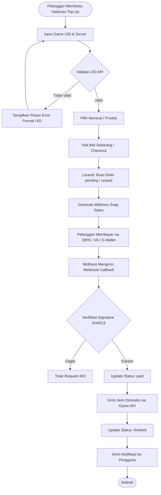
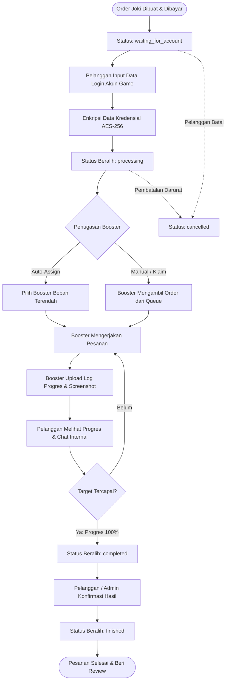

# Verand Store — Flowchart Alur Kerja

Dokumen ini memuat diagram alur proses bisnis utama di Verand Store.

---

## 1. Alur Transaksi Top-Up Otomatis

---

## 2. Alur Siklus Pengerjaan Jasa Joki (Stateful Workflow)

