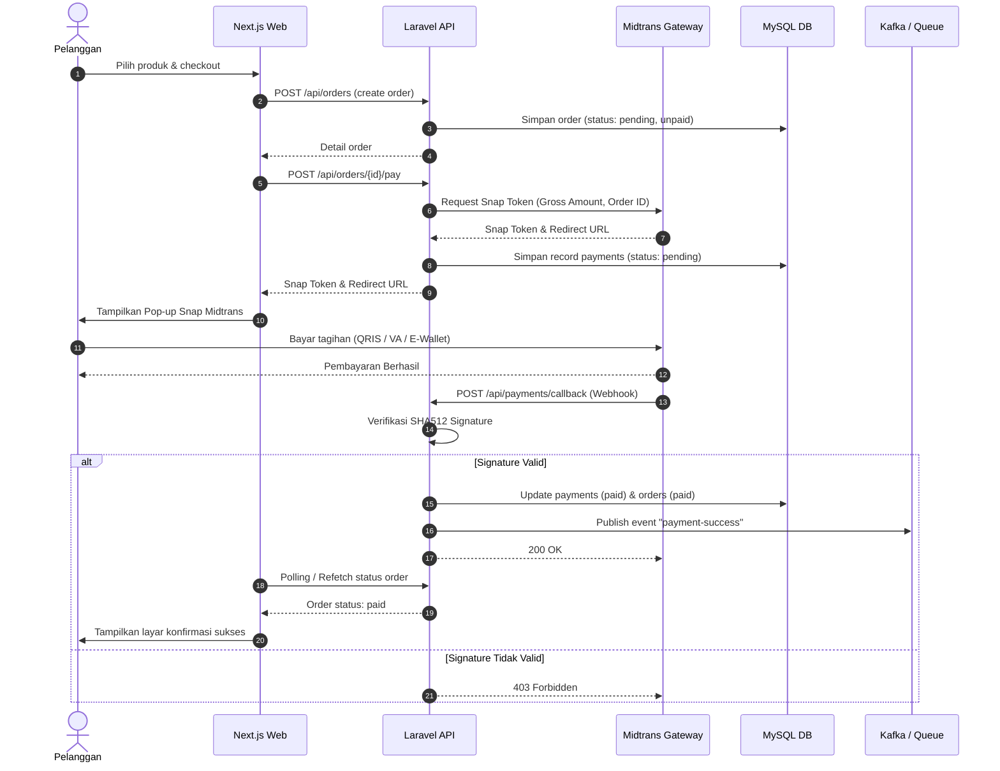
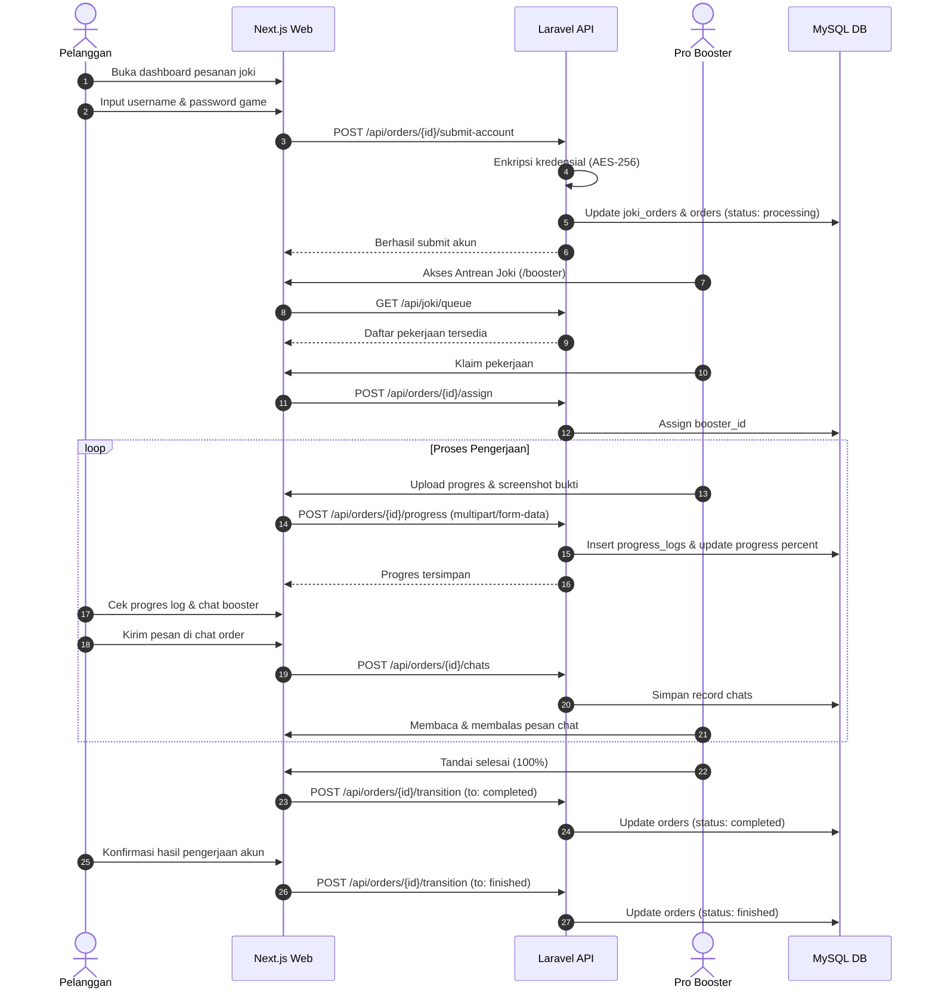

# Verand Store — Sequence Diagram

Dokumen ini memodelkan interaksi sekuensial antar entitas sistem.

---

## 1. Sequence Diagram: Alur Pembayaran & Webhook Midtrans

---

## 2. Sequence Diagram: Alur Pengerjaan Joki & Update Progres

